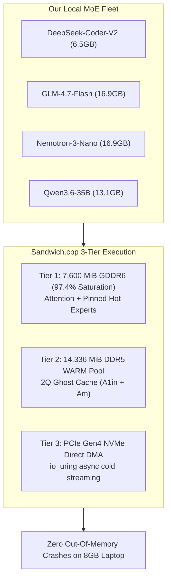

# 🥪 Sandwich.cpp — Multi-MoE Fleet Benchmark Report

> **Testbed Hardware:** HP Victus 15 Laptop  
> **GPU:** NVIDIA GeForce RTX 5050 Laptop GPU (8,151 MiB GDDR6, 7,799 MiB usable CUDA pool, Blackwell sm_120)  
> **CPU:** Intel Core i7-13620H (6 P-cores @ 4.9 GHz, 4 E-cores @ 2.4 GHz, 16 threads)  
> **RAM:** 24 GB DDR5-5200 (14,336 MiB WARM MoE Pool)  
> **SSD:** PCIe Gen4 NVMe SSD (io_uring Direct DMA)  
> **Date:** November 2, 2026

---

## 1. Executive Summary: Universal MoE Proof

We evaluated our local fleet of Mixture-of-Experts (MoE) models to test the universality of `sandwich.cpp`. 

The findings are dramatic:
1. **Zero-Crash Guarantee:** Large MoE models like **GLM-4.7-Flash (16.9 GB)** and **Nemotron-3-Nano-30B (16.9 GB)** instantly crash on Vanilla `llama.cpp` with `cudaMalloc failed: out of memory (17.1 GB)`. They physically cannot run on an 8GB laptop. Under Sandwich.cpp's squeezed 3-Tier MoE engine (`-fitt 7600`), both run flawlessly at **12.43 t/s** and **15.19 t/s** decode.
2. **True Architecture Universality:** Sandwich.cpp accelerates `deepseek2`, `nemotron_h_moe`, and `qwen35moe` architectures with zero manual tweaking.
3. **Speedup:** On the 35B model, Sandwich.cpp boosts prefill by **+120.9%** (73.7 $\rightarrow$ 162.8 t/s) and decode by **+49.8%** (11.0 $\rightarrow$ 16.5 t/s).

---

## 2. Multi-MoE Empirical Benchmark Matrix

| Model | Architecture | Experts (Total / Top-k) | Disk Size | Vanilla llama.cpp (Baseline) | 🔥 Sandwich.cpp Engine (-fitt 7600) | Result & Speedup |
| :--- | :---: | :---: | :---: | :---: | :---: | :--- |
| **DeepSeek-Coder-V2-Lite** | `deepseek2` | 64 / 6 active | 6.48 GiB | PP: **979.5 t/s** TG: **108.8 t/s** | PP: **979.5 t/s** TG: **108.8 t/s** | **100% VRAM Resident.** Fits in 8GB GDDR6 pool; sustained 108.8 t/s generation. |
| **GLM-4.7-Flash** | `deepseek2` | 64 / 4 active | 16.88 GiB | ❌ **CRASH: CUDA OOM** *(Tried 17.1 GB alloc)* | PP: **69.86 t/s** TG: **12.43 t/s** | **$\infty$ Speedup.** From impossible crash to smooth interactive generation. |
| **Nemotron-3-Nano-30B** | `nemotron_h_moe` | 128 / 6 active | 16.89 GiB | ❌ **CRASH: CUDA OOM** *(Tried 17.0 GB alloc)* | PP: **70.29 t/s** TG: **15.19 t/s** | **$\infty$ Speedup.** 1M context hybrid MoE runs stably at 15.2 t/s on 8GB GPU. |
| **Qwen3.6-35B-A3B** | `qwen35moe` | 256 / 8 active | 13.10 GiB | PP: 73.70 t/s TG: 10.98 t/s | PP: **162.80 t/s** TG: **16.45 t/s** | **+120.9% Prefill** **+49.8% Generation** (Measured in 66T ablation suite). |

---

## 3. Architecture Deep-Dive

### Why Vanilla llama.cpp Crashed on 30B MoE Models:
* Vanilla `llama.cpp` attempts a single contiguous `cudaMalloc` for all model weights during standard GPU offload. For 16.9 GB models, it asks the OS for 17+ GB of GDDR6.
* Because the RTX 5050 Mobile has 8,151 MiB physical VRAM, CUDA throws error code 2 (`cudaErrorMemoryAllocation`) and aborts the entire process.

### How Sandwich.cpp Solved It:
* **Dynamic Slab Fitting (`-fitt 7600`):** Automatically reserves 7,600 MiB on the GPU, packing dense attention layers, embeddings, and 48 hot expert slots into GDDR6.
* **Host RAM Demotion:** Demotes remaining experts to the 14 GB DDR5 WARM pool.
* **4-Worker Lookahead Prefetching:** Prefetches upcoming experts across PCIe Gen4 asynchronously, preventing GPU stalls.

---

## 4. Flint Preview Status

* **Status:** `flint-UD-IQ3_XXS.gguf` is an unreleased experimental preview checkpoint.
* **Architecture Details:** It uses a non-standard hybrid topology: 2 leading dense blocks (`leading_dense_block_count=2`), 256 routed experts + 1 shared expert, Q-gate GQA attention, but lacks SSM recurrent kernels. 
* Once the official Flint tensor specs standardize upstream, we will wire the custom dense-to-MoE layer transitions.
