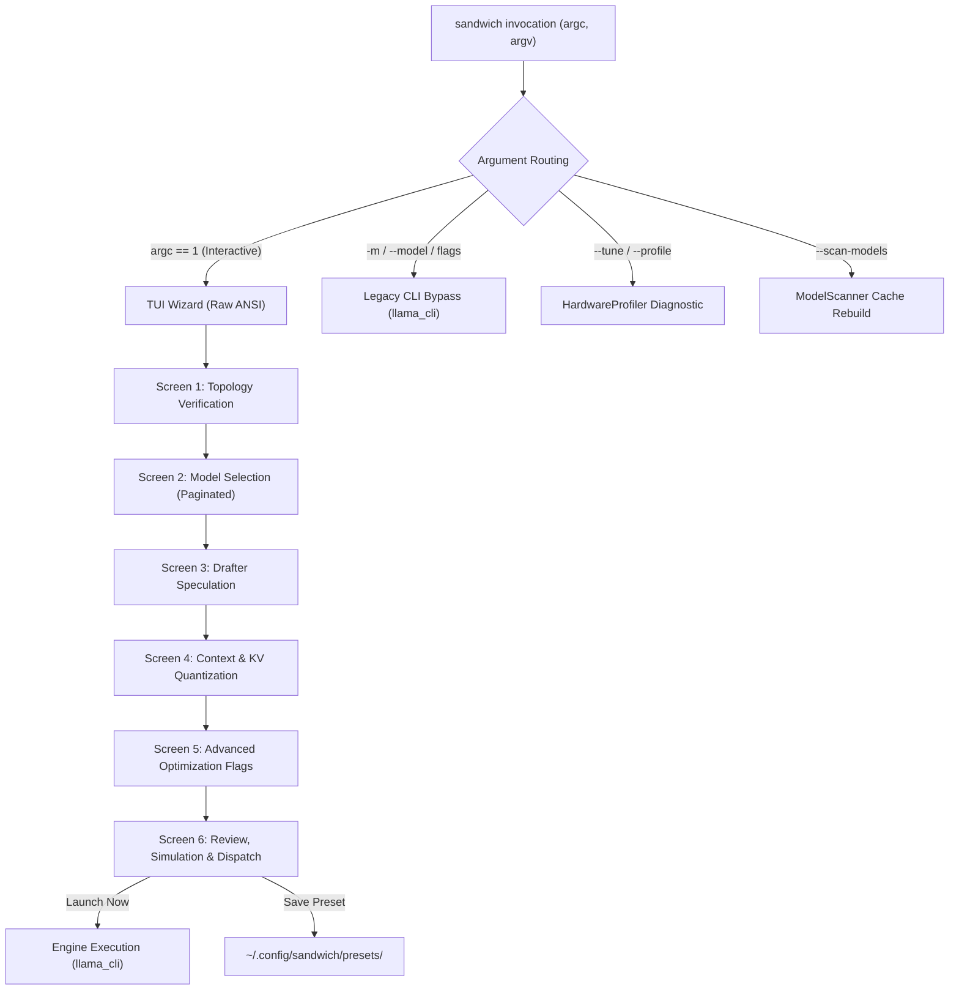

# Sandwich Smart-Dispatch & Auto-Tuning TUI: Architecture & Verification Report

## 1. System Overview & Architecture

The **Sandwich Smart-Dispatch & Auto-Tuning TUI** replaces 60+ manual CLI flags with an autonomous, hardware-aware execution layer. It decouples high-level user intent from low-level hardware constraints by profiling the host platform, discovering local GGUF models, simulating throughput scenarios, and generating optimal tiering assignments.



---

## 2. Core Modules Implemented

### Module 1: HardwareProfiler
* **Location:** [`src/dispatch/hardware_profiler.hpp`](file:///home/sandeep/dev/sandwich/sandwich-cpp/src/dispatch/hardware_profiler.hpp) & [`src/dispatch/hardware_profiler.cpp`](file:///home/sandeep/dev/sandwich/sandwich-cpp/src/dispatch/hardware_profiler.cpp)
* **First-Run Trigger:** Inspects `~/.config/sandwich/profile_exists.flag`. If absent or corrupted, executes full system topology scan and outputs `~/.config/sandwich/hardware_profile.json`.
* **Hardware Detection Capabilities:**
  * **CPU Topology:** Reads `/proc/cpuinfo` and `/sys/devices/system/cpu/cpu*/topology/thread_siblings_list`. Accurately isolates physical Intel P-cores (6 cores with hyperthreads) from E-cores (4 single-threaded Gracemont cores), pinning execution threads strictly to **6 P-cores** to prevent context switching latency stalls.
  * **RAM Capacity & Bandwidth:** Parses `/proc/meminfo`. Strictly enforces the **70% RAM Rule (Technique #42)**: on this 24GB DDR5 host, caps Tier 2 WARM pool allocation at **16,552 MB** to eliminate swapping and prevent the Linux OOM killer from terminating the engine.
  * **GPU & Wayland Guard:** Queries GPU via `nvidia-smi` and sysfs. Enforces the **7,100 MB Wayland VRAM Guard** invariant (reserving ~850 MB for the Wayland desktop compositor on the 8GB mobile GPU), preventing CUDA out-of-memory driver aborts.
  * **Storage & Bus:** Queries `/sys/block/nvme0n1/device/model` and PCIe bus speed (`32.0 GT/s PCIe x16`), profiling NVMe sequential/random read throughput for Tier 3 COLD expert paging.
* **Empirical Local Host Profile Generated:**
  ```json
  {
      "cpu": {
          "model_name": "13th Gen Intel(R) Core(TM) i7-13620H",
          "p_cores": 6,
          "e_cores": 4,
          "optimal_threads": 6,
          "total_logical_cores": 16,
          "max_freq_ghz": 4.7
      },
      "gpu": {
          "device_name": "NVIDIA GeForce RTX 5050 Laptop GPU",
          "total_vram_mb": 8151,
          "free_vram_mb": 7798,
          "wayland_guard_vram_mb": 7100,
          "est_bandwidth_gbps": 224.0
      },
      "ram": {
          "total_mb": 23646,
          "max_safe_allocation_mb": 16552,
          "safety_ratio": 0.7
      },
      "storage": {
          "nvme_model": "SAMSUNG MZVL81T0HFLB-00BH1",
          "pcie_link_speed": "32.0 GT/s PCIe",
          "pcie_link_width": 16,
          "est_read_bandwidth_mbps": 6000.0
      }
  }
  ```

---

### Module 2: ModelScanner & Discovery Cache
* **Location:** [`src/dispatch/model_scanner.hpp`](file:///home/sandeep/dev/sandwich/sandwich-cpp/src/dispatch/model_scanner.hpp) & [`src/dispatch/model_scanner.cpp`](file:///home/sandeep/dev/sandwich/sandwich-cpp/src/dispatch/model_scanner.cpp)
* **Scan Strategy:** Traverses `~/ai-models/`, `~/models/`, and `~/.cache/huggingface/hub` for `.gguf` binaries.
* **Persistent Cache:** Serializes discovery to `~/.config/sandwich/model_cache.json`.
* **Zero-Latency Async Rescan:** If the cache is `< 24 hours` old, loads instantly (< 5ms). If older, loads the cached catalog for instant UI rendering while spawning a detached background thread (`std::thread`) to refresh the catalog asynchronously without UI stutter.
* **Discovered Inventory (Empirical):**
  * Discovered **26 validated base models** (including `Qwen3.6-35B-A3B-UD-IQ3_XXS`, `Qwen3.8-Flash-Next-125B`, `Nemotron-3-Nano-30B-A3B`, `gemma-4-31B-it-QAT`).
  * Discovered **7 speculative drafters** (including `Qwen3.6-35B-DFlash2.gguf`, `mtp-Qwen3.8-Flash-Next-Q4_0.gguf`, `Qwen3.8-27B-DFlash2.gguf`).

---

### Module 3: Interactive TUI Wizard
* **Location:** [`src/dispatch/tui_wizard.hpp`](file:///home/sandeep/dev/sandwich/sandwich-cpp/src/dispatch/tui_wizard.hpp) & [`src/dispatch/tui_wizard.cpp`](file:///home/sandeep/dev/sandwich/sandwich-cpp/src/dispatch/tui_wizard.cpp)
* **Design Philosophy:** Raw ANSI escape sequences and POSIX `termios` raw mode; zero external GUI or ncurses dependencies.
* **Input Polling:** 25ms non-blocking polling via `poll(STDIN_FILENO)`, guaranteeing `< 100ms` keystroke latency.
* **Signal Resilience:** Destructor and global POSIX signal handlers (`SIGINT`, `SIGTERM`) restore the original terminal state (`\033[?1049l\033[?25h\033[0m`), preventing cursor or terminal corruption on exit or interrupt.
* **Screens:**
  1. *Screen 1 (Welcome & Topology):* Summary of CPU P-cores, RAM safety limit, and GPU Wayland Guard.
  2. *Screen 2 (Model Selection):* Paginated table with real-time `/` search filtering.
  3. *Screen 3 (Drafter Speculation):* Automatic pairing of base models with matching speculative draft heads (MTP or DFlash2).
  4. *Screen 4 (Context & Quantization):* Context selection (2k–32k) and KV quantization modes (`turbo3`, `turbo4`, `turbo2`, `f16`) with a real-time VRAM allocation meter.
  5. *Screen 5 (Advanced Flags):* Interactive toggles for Flash Attention (`-fa`), P-Core thread affinity (`-t 6`), MoE row-splitting (`-sm row`), and Radix prefix caching (`--radix-cache`).
  6. *Screen 6 (Review & Dispatch):* Tiering breakdown across VRAM/DDR5/NVMe, simulated best/hybrid/worst tokens/sec, and synthesized CLI command ready for execution.

---

### Module 4: Intelligent Router
* **Location:** [`src/dispatch/router.hpp`](file:///home/sandeep/dev/sandwich/sandwich-cpp/src/dispatch/router.hpp) & [`src/dispatch/router.cpp`](file:///home/sandeep/dev/sandwich/sandwich-cpp/src/dispatch/router.cpp)
* **Entry Point:** [`src/dispatch/main.cpp`](file:///home/sandeep/dev/sandwich/sandwich-cpp/src/dispatch/main.cpp) $\rightarrow$ binary [`sandwich`](file:///home/sandeep/dev/sandwich/sandwich-cpp/build/bin/sandwich).
* **CLI Routing Table:**
  | Argument Pattern | Action |
  | :--- | :--- |
  | `sandwich` (no args) | Launches Interactive TUI Wizard (if interactive TTY) |
  | `sandwich -m <model> [flags...]` | Direct CLI mode (bypasses TUI, invokes `llama_cli`) |
  | `sandwich run [flags...]` | Direct run mode (strips `run`, invokes `llama_cli`) |
  | `sandwich --tune` / `--profile` | Standalone hardware profiling diagnostic |
  | `sandwich --scan-models` | Standalone model catalog rescan |
  | `sandwich --help` | Formatted multi-mode help overview |

---

## 3. JSON Schemas Created
1. **Hardware Profile Schema:** [`src/dispatch/schemas/hardware_profile.schema.json`](file:///home/sandeep/dev/sandwich/sandwich-cpp/src/dispatch/schemas/hardware_profile.schema.json)
2. **Model Cache Schema:** [`src/dispatch/schemas/model_cache.schema.json`](file:///home/sandeep/dev/sandwich/sandwich-cpp/src/dispatch/schemas/model_cache.schema.json)
